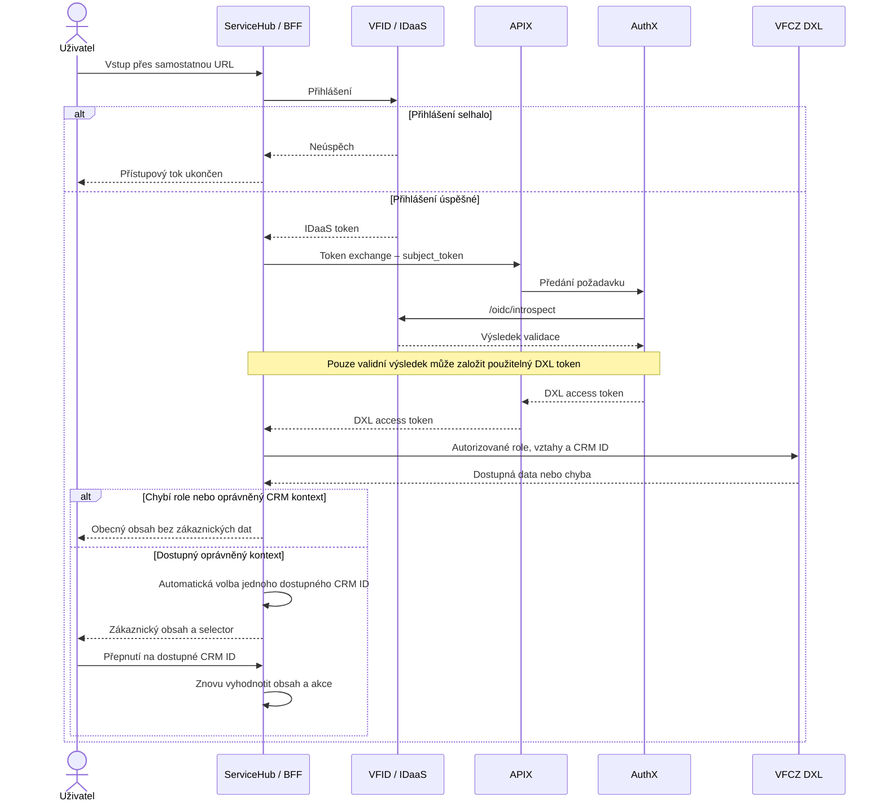
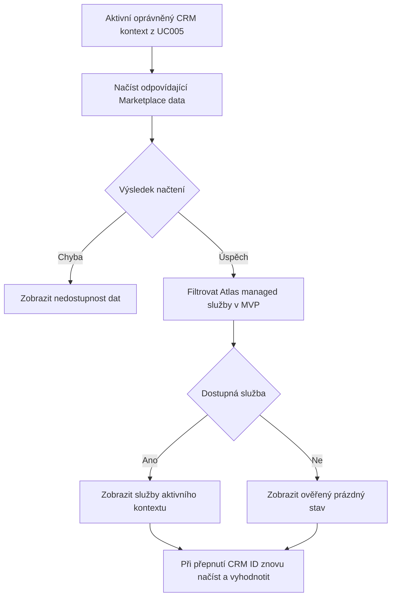
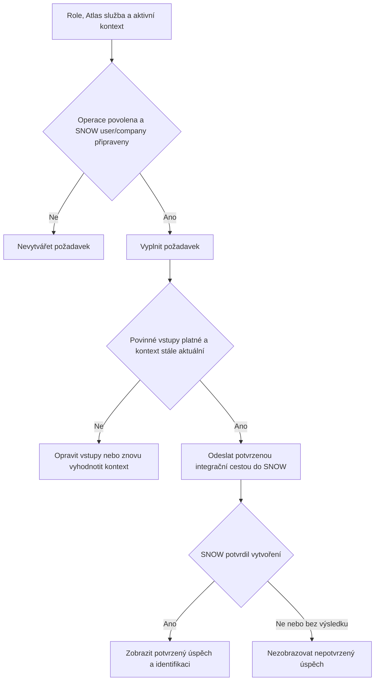
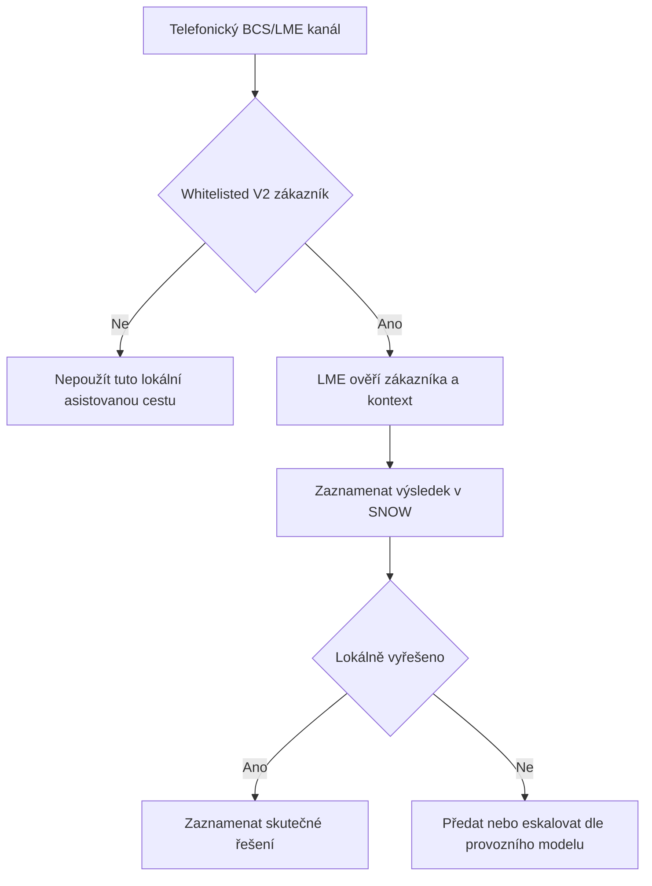
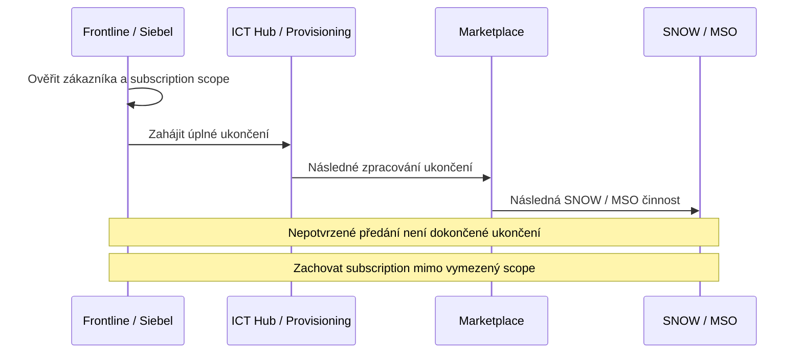
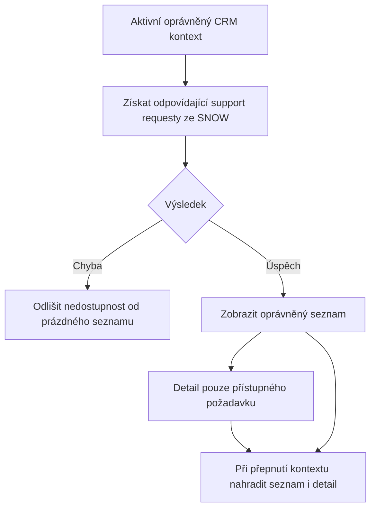
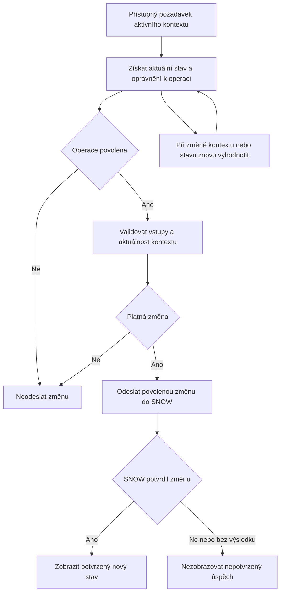

# ServiceHub – logické scénáře MVP

Pracovní funkční návrh, 4. 11. 2026. Vychází z primárních UC005–UC011 zaznamenaných v kontrolní matici a tokenového návrhu emailu „RE: ServiceHub - DXL“, 15. 10. 2026. Diagramy vyjadřují odpovědnosti a pořadí podmínek; neurčují nepotvrzené API endpointy, payloady, role enumy ani produkční oprávnění. Čísla podmínek odkazují na EA_UC_traceability.json. Nejde o potvrzení nasazení.

## UC005 – přihlášení a kontext (podmínky 1–7)

Priorita první volby je otevřená. Nedostupný kontext se nesmí aktivovat; při jeho ztrátě se obnoví selector. Technická chyba DXL se nesmí vydávat za úspěšně zjištěnou absenci vztahů. VFID sub ↔ příslušný ONSC/WSC user je 1:1; více CRM kontextů je samostatný vztah. TMF691 poskytuje CRM_ID; potřebné customer name je samostatný lookup TMF629. Holding payload není doplněn odhadem.

## UC006 – Atlas služby (podmínky 8–11)

Konkrétní převod CRM ID na Marketplace company UUID, pole a subscription stavy vyžadují kontrakt. Žádný automatický Siebel prefill ani ONSC/WSC navigační handover není tímto zaveden.

## UC007 – vytvoření support requestu (podmínky 12–15)

Konkrétní mandatory fields, routing, assignment, timeout, retry a ochrana proti duplicitám zůstávají technickým návrhem k potvrzení. V4 customer/admin onboarding je manuální MVP; není novou automatickou provisioning sekvencí.

## UC008 – asistovaná podpora (podmínky 16–18)

BCS je kanál a LME lidská role. Diagram nezavádí novou aplikaci. Správa whitelistu, resolver skupiny a fallback se musí doložit provozním postupem.

## UC009 – úplné ukončení (podmínky 19–21)

Jde o logický procesní směr, nikoli specifikaci přímých API volání. ServiceHub se nestává novým prodejním ani termination vstupem. Downgrade se zachováním M365 je UC004, neslučuje se s úplným ukončením UC009. Efektivní datum a zotavení po selhání vyžadují kontrakt.

## UC010 – seznam a detail (podmínky 22–25)

Obecné „all tickets“ neprokazuje oprávnění ke všem SNOW typům nebo všem společnostem. Detail musí podléhat stejnému customer scope jako seznam. Pagination, sorting, status mapping a cache nejsou odhadovány.

## UC011 – změna požadavku (podmínky 26–30)

Company scope není porovnání emailu. Povolené update operace, komentáře, attachments, stavové přechody a souběh změn musí určit příslušný SNOW kontrakt. Diagram je nevymýšlí.

## Akceptační a modelová návaznost

Všech 30 kontrolovatelných podmínek, návrhy jejich ověření a původní FREQ GUIDy jsou v EA_UC_traceability.json. Prázdná množina kandidátů je viditelná mezera v porovnávané sadě, nikoli automatické nové FREQ/SREQ ID. Existující obecný požadavek na refresh neprokazuje splnění konkrétního submit/update scénáře. Návrh proto nesmí generovat úplné realization vztahy jen podle shody čísel.
